# QRL-Lab: σύνοψη υλοποιήσεων και πειραμάτων (Sim v2.1)

> ΔΙΕΡΕΥΝΗΤΙΚΟ / ΠΡΟΣΩΡΙΝΟ: τα gates (preflight, rev-1) απέτυχαν και ο simulator δεν είναι βαθμονομημένος. Τα νούμερα δεν είναι αποτέλεσμα για paper. Κανένας RL agent δεν έχει εκπαιδευτεί σε αυτά τα runs.

## Τι αλλάξαμε

- Sim v2 -> v2.1: νέα knobs ευαισθησίας (latency_add, tail_scale, cpu_offset, rebalance k/delta, theta) με παγωμένες τιμές στο `code/sim_v2/sensitivity_v21.json`. Οι default τιμές δίνουν bit-identical αποτελέσματα με το v2.
- Πρωτόκολλο dinos_simv2: freeze (hash + git), preflight, diagnose, rev-1 gate με seeds 1200-1209, παγωμένος baseline K8sHPA (`docs/hpa_spec.md`).
- ΟΛΑ τα παράμετρα του simulator είναι προσωρινά και μη βαθμονομημένα.

## Τι τρέξαμε

- R-20261017-004 (preflight): threshold vs fixed(22), 5 seeds (1000-1004).
- R-20261017-010 (diagnose): traces ανά βήμα, accounting startup/rest, sensitivity (ίδια 5 seeds, χωρίς re-tuning).
- R-20261017-013 (rev-1 gate): c0=6, 10 seeds (1200-1209), threshold vs static_ramp(22), fixed_best, oracle.
- Δεν έχει εκπαιδευτεί κανένας RL agent (DERP, DInos, LSTM) ακόμη. Το W0 run R-20261017-015 δεν έχει τρέξει.

## Τι δοκιμάσαμε

- Αν ο threshold (40/25/0) ξεπερνά απλούς ελεγκτές: static_ramp(22) (ξεκινά από 6 pods και ανεβαίνει), fixed(22) προ-παρασχεμένο, always_min/max, και clairvoyant oracle.
- Αν η κατάταξη αντέχει σε αλλαγές των παραμέτρων (sensitivity, 10 configs).

## Τι βγήκε

- Preflight (R-004): threshold -140.9k vs fixed(22) -123.3k, νίκες 0/5. FAIL.
- Rev-1 (R-013): threshold -133.1k vs static_ramp -126.2k, διαφορά -6.9k, 95% CI [-8.5k, -5.2k], νίκες 0/10. FAIL. Oracle -101.6k, fixed_best -120.8k, always_max -157.2k, always_min -3.55M.
- K8sHPA (dev seeds 1000-1004): καλύτερο target 40% με -127.9k (threshold -140.9k, fixed(22) -123.3k στα ίδια seeds). Μόνο dev, in-sample.
- Συμπέρασμα: τα gates απέτυχαν, ο simulator δεν είναι βαθμονομημένος. Όλα τα παρακάτω είναι διερευνητικά (exploratory) και προσωρινά.

## Αντιστοίχιση σχημάτων DInos ↔ δικά μας

| DInos | Τι δείχνει | Δικό μας σχήμα | Κατάσταση |
|---|---|---|---|
| Fig 4 | Input metrics (load, CPU, memory, latency, 5000 steps) | fig4_input_metrics.png | Αντίστοιχο (αναλογία): load/CPU/latency από το sim. Η μνήμη δεν μοντελοποιείται, δείχνουμε backlog. |
| Fig 5 | DERP/DInos reward ανά checkpoint (1k-20k) | fig5_checkpoints_analogue.png | ΔΕΝ ΥΠΑΡΧΕΙ ακόμη (χωρίς agents). Δείχνουμε baselines. Χρειάζεται R-20261017-015. |
| Fig 6 left | DERP: metrics + pods, 5000 steps | fig6_left_threshold.png | Αναλογία: αντιδραστικός threshold baseline, όχι DERP. |
| Fig 6 right | DInos: metrics + pods, 5000 steps | fig6_right_oracle.png | Αναλογία: clairvoyant oracle (όριο), ΟΧΙ DInos. |
| Fig 7 left | Real cluster: αθροιστικό reward 2000 steps, DInos vs LSTM-only | fig7_left_cumulative_reward.png | Μερική αναλογία: αθροιστικό reward baselines στο sim. Real run ΔΕΝ υπάρχει. |
| Fig 7 right | Real cluster: metrics + Redis pods | fig7_right_sim_timeseries.png | Μερική αναλογία: sim trace (ίδιο στυλ). Real run ΔΕΝ υπάρχει. |
| Fig 8 | Πίνακας reward/CPU/μνήμη/latency, DERP vs DInos, sim και real | fig8_summary_table.png | Μερικός πίνακας: baselines στο sim. DERP/DInos/real: not available. |

Τα Fig 1-3 του DInos είναι αρχιτεκτονικά διαγράμματα, όχι αποτελέσματα, και δεν αναπαράγονται.

## Fig 4: Input metrics (load, CPU, memory, latency, 5000 steps)

*DInos:* Fig 4 (DInos): input metrics from the simulation (load, CPU, memory, latency) over 5000 timesteps; sinusoid + Gaussian noise + spike at 1500-1600.

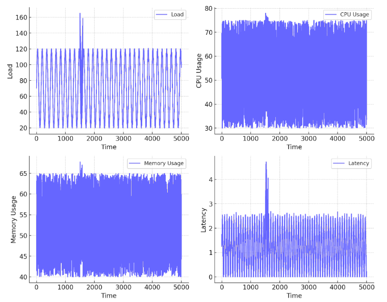

*Δικό μας (Αντίστοιχο (αναλογία): load/CPU/latency από το sim. Η μνήμη δεν μοντελοποιείται, δείχνουμε backlog.):*

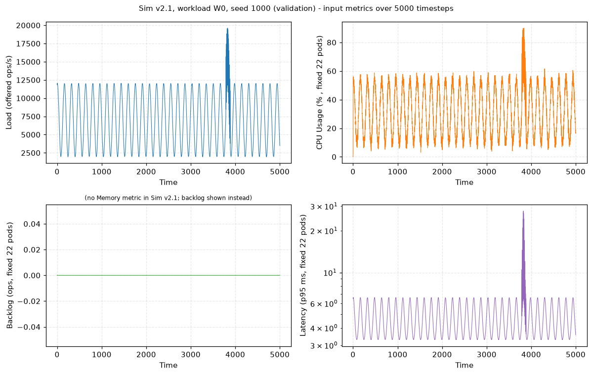

Δείχνει τα μεγέθη εισόδου του simulator σε ένα επεισόδιο 5000 βημάτων (seed 1000): offered load (ημιτονοειδές με spike), CPU, backlog και p95 latency με 22 σταθερά pods. Στο DInos το load έχει επίσης ημίτονο, θόρυβο και spike στα 1500-1600. Στο δικό μας W0 το spike διαρκεί 100 βήματα σε τυχαία θέση ανά seed (`code/sim_v2/workloads.py`), και η φάση του ημιτόνου είναι επίσης τυχαία ανά seed. Οι κλίμακες διαφέρουν (ops/s, ms) και δεν υπάρχει μνήμη, άρα η σύγκριση είναι μόνο ποιοτική.

## Fig 5: DERP/DInos reward ανά checkpoint (1k-20k)

*DInos:* Fig 5 (DInos): total accumulated reward of DERP (left) and DInos (right) at 1k, 2k, 5k, 10k, 20k training steps.

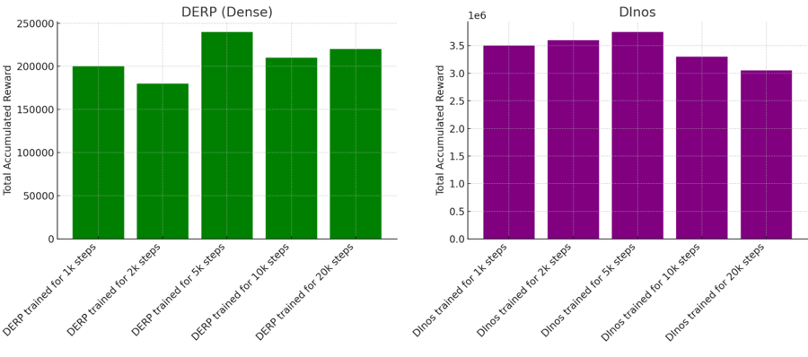

*Δικό μας (ΔΕΝ ΥΠΑΡΧΕΙ ακόμη (χωρίς agents). Δείχνουμε baselines. Χρειάζεται R-20261017-015.):*

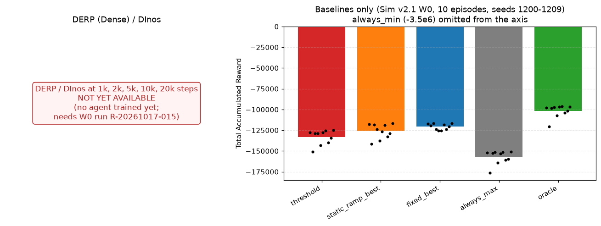

Το DInos δείχνει reward ανά αριθμό βημάτων εκπαίδευσης για DERP και DInos. Εμείς δεν έχουμε εκπαιδευμένους agents, άρα το αριστερό πάνελ είναι κενό (not yet available). Δεξιά βλέπεις το συνολικό reward των baselines σε 10 επεισόδια (seeds 1200-1209, rev-1): threshold -133.1k, static_ramp -126.2k, fixed_best -120.8k, always_max -157.2k, oracle -101.6k. Το reward είναι αρνητικό (κόστος), όχι θετικό όπως στο DInos, άρα οι τιμές δεν συγκρίνονται άμεσα.

## Fig 6 left: DERP: metrics + pods, 5000 steps

*DInos:* Fig 6 left (DInos): DERP runtime metrics and pod count over 5000 timesteps; reactive, over/under-provisions.

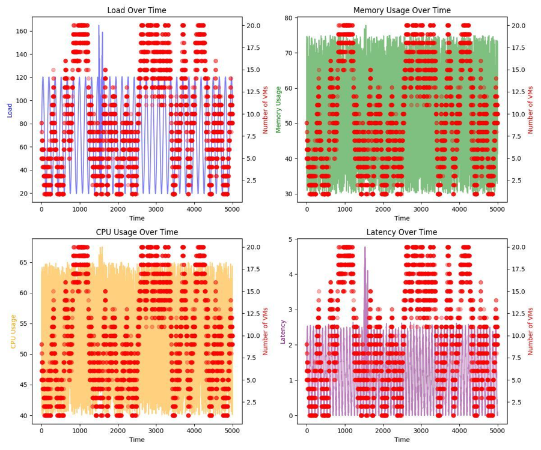

*Δικό μας (Αναλογία: αντιδραστικός threshold baseline, όχι DERP.):*

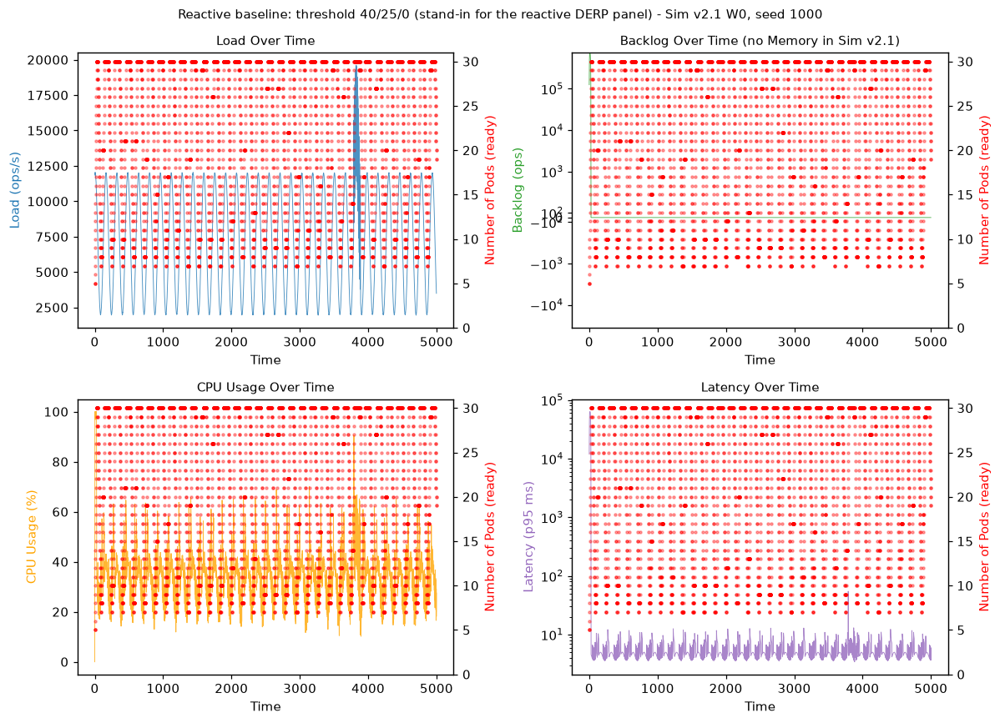

Στο DInos το αριστερό διάγραμμα δείχνει τον DERP που αντιδρά μετά το γεγονός. Εδώ χρησιμοποιούμε τον threshold baseline (όχι DERP) ως αντιδραστικό ελεγκτή: ανεβαίνει σε 30 pods (μέγιστο) κατά την εκκίνηση και μετά ταλαντεύεται γύρω από το φορτίο. Το reward έχει ποινή SLA, άρα η αρχική φάση (startup) κοστίζει. Μην διαβάσεις το σχήμα ως αποτέλεσμα DERP.

## Fig 6 right: DInos: metrics + pods, 5000 steps

*DInos:* Fig 6 right (DInos): DInos runtime metrics and pod count over 5000 timesteps; anticipates load.

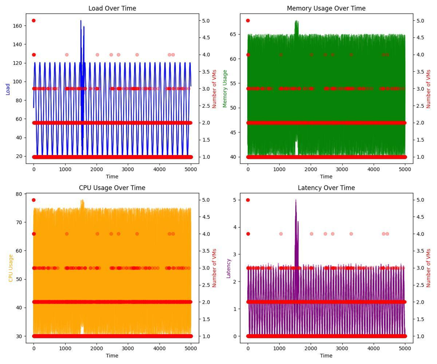

*Δικό μας (Αναλογία: clairvoyant oracle (όριο), ΟΧΙ DInos.):*

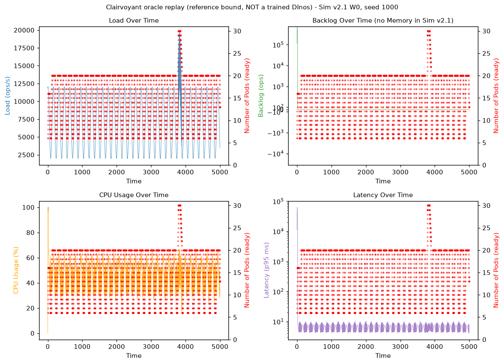

Στο DInos το δεξί διάγραμμα είναι ο DInos με λίγα pods. Εδώ βάζουμε τον oracle replay, που ξέρει το μέλλον και είναι άνω όριο, όχι εκπαιδευμένος agent. Χρησιμοποιεί λιγότερα pods (μέσος όρος 15.9 έναντι 22.2 του threshold) και έχει return -108.4k (seeds 1000-1004) έναντι -140.9k. Δείχνει πόσο περιθώριο υπάρχει, όχι ότι το DInos θα το πετύχει.

## Fig 7 left: Real cluster: αθροιστικό reward 2000 steps, DInos vs LSTM-only

*DInos:* Fig 7 left (DInos): real Kubernetes/Redis, cumulative reward over 2000 timesteps, DInos 308,000 vs LSTM-only 56,000.

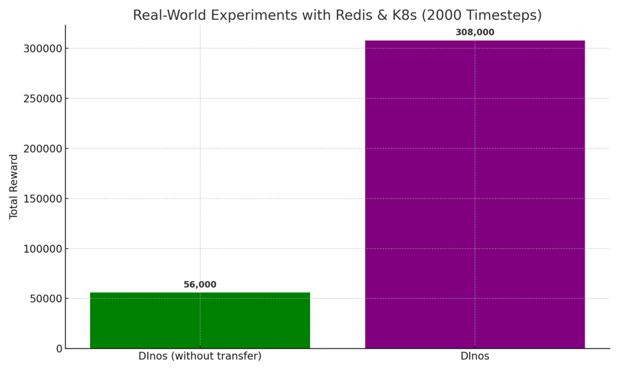

*Δικό μας (Μερική αναλογία: αθροιστικό reward baselines στο sim. Real run ΔΕΝ υπάρχει.):*

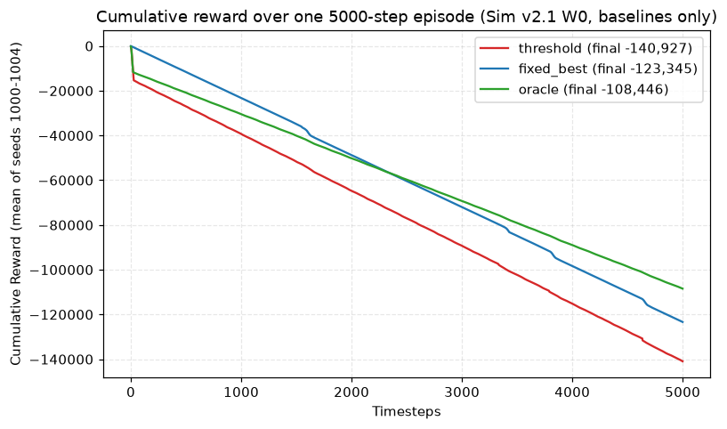

Το DInos δείχνει αθροιστικό reward 2000 βημάτων σε πραγματικό cluster (308,000 vs 56,000). Εμείς δεν έχουμε real-cluster run αυτού του τύπου. Δείχνουμε το αθροιστικό reward των baselines στο sim (μέσος όρος seeds 1000-1004, 5000 βήματα): τελικά threshold -140,927, fixed(22) -123,345, oracle -108,446. Ο threshold ξεκινά από 5-6 pods και ανεβαίνει σταδιακά, ενώ το fixed(22) είναι προ-παρασχεμένο, άρα η εκκίνηση (πρώτα 150 βήματα) είναι ένα μέρος της διαφοράς (accounting στο diagnose: startup threshold -18.4k έναντι fixed -3.5k).

## Fig 7 right: Real cluster: metrics + Redis pods

*DInos:* Fig 7 right (DInos): real cluster, load/CPU/memory/latency and number of Redis pods over 2000 timesteps.

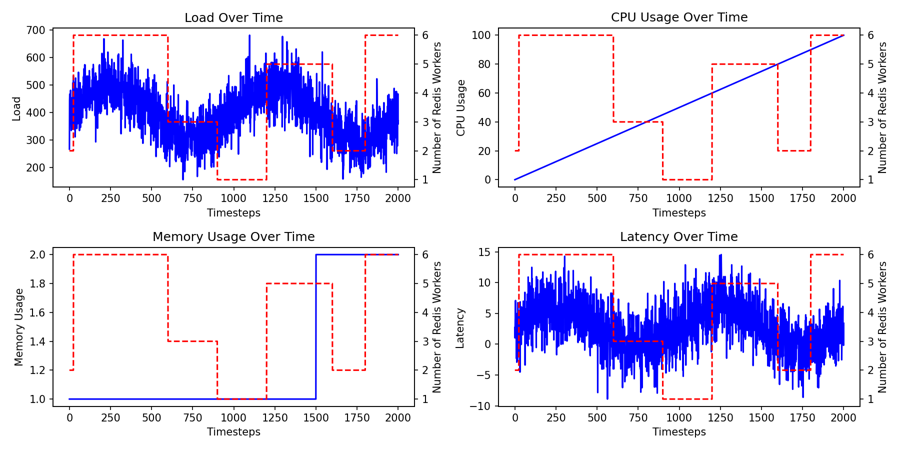

*Δικό μας (Μερική αναλογία: sim trace (ίδιο στυλ). Real run ΔΕΝ υπάρχει.):*

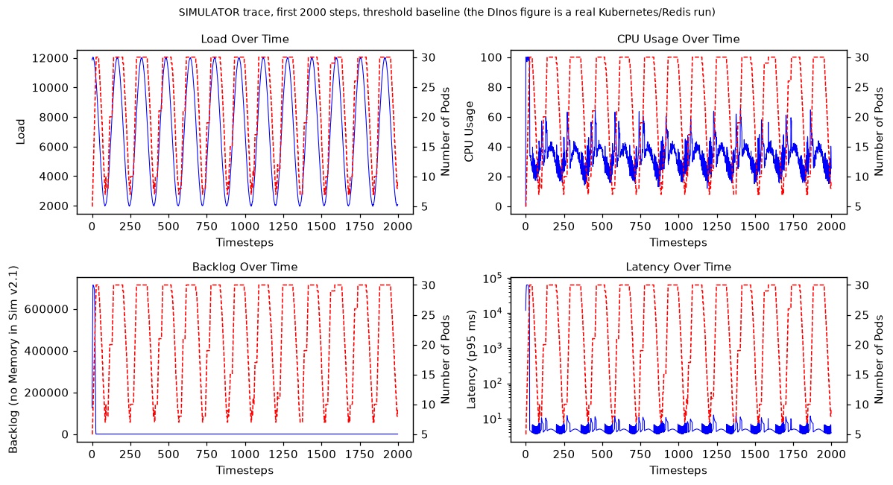

Στο DInos είναι ο χρονικός ρυθμός metrics και pods από ζωντανό Kubernetes/Redis. Εδώ δείχνουμε τα πρώτα 2000 βήματα ενός trace του simulator (threshold baseline) στο ίδιο στυλ (μπλε γραμμή, κόκκινα διακεκομμένα pods). Δεν είναι πραγματική μέτρηση και δεν υπάρχει agent. Οι calibration runs του Οκτωβρίου μετρούν το cluster, δεν τρέχουν autoscaler.

## Fig 8: Πίνακας reward/CPU/μνήμη/latency, DERP vs DInos, sim και real

*DInos:* Fig 8 (DInos): summary table, DERP vs DInos, simulation and real world (reward 220k vs 3.8M; 56k vs 308k).

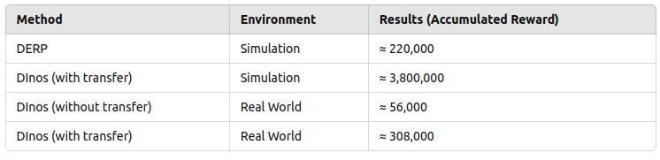

*Δικό μας (Μερικός πίνακας: baselines στο sim. DERP/DInos/real: not available.):*

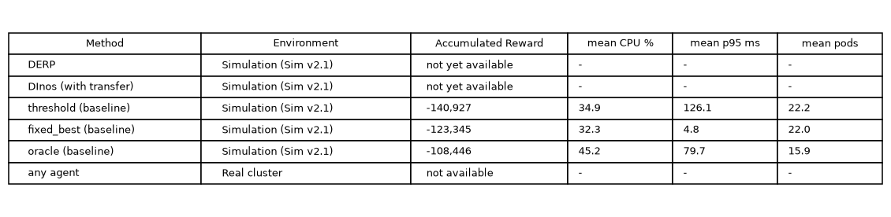

Ο πίνακας του DInos συγκρίνει reward, CPU, μνήμη και latency. Εδώ ο πίνακας έχει μόνο baselines στο sim (seeds 1000-1004, mean): threshold -140,927, fixed(22) -123,345, oracle -108,446. Οι γραμμές DERP, DInos και real cluster είναι κενές (not available). Η μνήμη δεν υπάρχει στο sim, το CPU είναι το παρατηρούμενο (με θόρυβο), το latency είναι ο μέσος p95 σε ms. Ο μέσος p95 του threshold κυριαρχείται από το startup (αρχικό backlog). Τα threshold/fixed(22) είχαν επιλεγεί στα ίδια seeds (in-sample).

| Method | Environment | Accumulated Reward | mean CPU % | mean p95 ms | mean pods |
|---|---|---|---|---|---|
| DERP | Simulation (Sim v2.1) | not yet available | - | - | - |
| DInos (with transfer) | Simulation (Sim v2.1) | not yet available | - | - | - |
| threshold (baseline) | Simulation (Sim v2.1) | -140,927 | 34.9 | 126.1 | 22.2 |
| fixed_best (baseline) | Simulation (Sim v2.1) | -123,345 | 32.3 | 4.8 | 22.0 |
| oracle (baseline) | Simulation (Sim v2.1) | -108,446 | 45.2 | 79.7 | 15.9 |
| any agent | Real cluster | not available | - | - | - |

## Επιπλέον σχήματα (χωρίς αντίστοιχο στο DInos)

### Έξτρα A: rev-1 gate, διαφορά ανά επεισόδιο

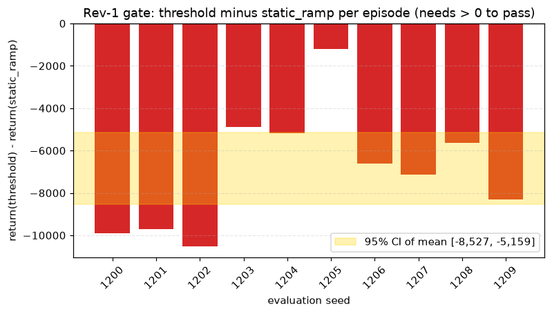

Κάθε μπάρα είναι return(threshold) μείον return(static_ramp) στο ίδιο seed. Όλες είναι αρνητικές: 0/10 νίκες, μέση διαφορά -6,911, CI [-8,527, -5,159]. Άρα ο threshold δεν περνά το gate. Πηγή: 20261017-152657-R-20261017-013-e0-a1/preflight_rev1.json.

### Έξτρα B: ρύθμιση K8sHPA (dev seeds)

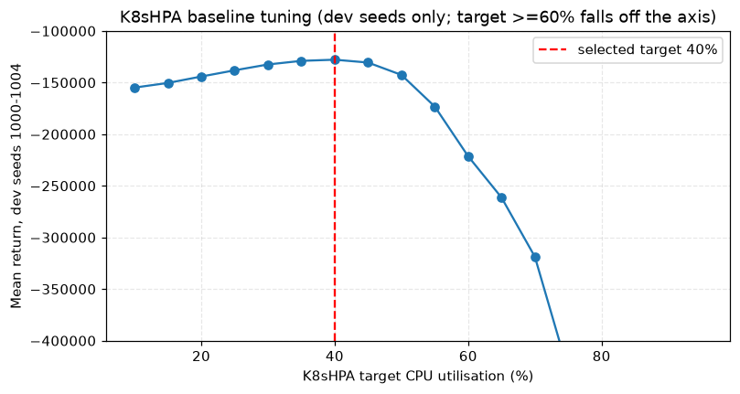

Το mean return του K8sHPA ανά target CPU %. Βέλτιστο στο 40% (-127,860), εσωτερικό σημείο του grid. Μόνο dev seeds, δεν είναι αποτέλεσμα αξιολόγησης. Πηγή: code/experiments/dinos_simv2/hpa_selection_dev.json.

### Έξτρα Γ: ευαισθησία του simulator

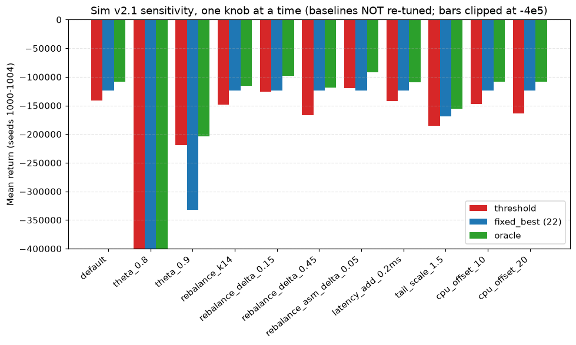

Mean return ανά config (ένα knob τη φορά, χωρίς re-tuning). Ο συσχετισμός threshold/fixed αλλάζει: π.χ. θ=0.9 threshold -219.5k vs fixed -332.7k, rebalance_asm_delta_0.05 threshold -119.4k vs fixed -123.3k. Άρα η κατάταξη εξαρτάται από παραμέτρους που δεν έχουμε μετρήσει. θ=0.8 είναι εκτός κλίμακας (clip στο -4e5). Πηγή: 20261017-145935-R-20261017-010-e0-a1/diagnose.json.

Σημείωση παραγωγής: τα σχήματα φτιάχνονται από `code/experiments/dinos_simv2/make_report_figs.py` με ανάγνωση των αποθηκευμένων traces (seeds 1000-1004) και των per-episode returns (seeds 1200-1209). Δεν έτρεξε simulator, εκπαίδευση ή νέα seeds. Τα seeds 1300+ και 20000+ δεν αγγίχθηκαν. Τα traces των 1000-1004 είναι in-sample (threshold και fixed(22) επιλέχθηκαν εκεί). Το static_ramp δεν έχει traces ανά βήμα, μόνο returns.
